

  

<h1 align="center">TeeUp</h1>

  <strong>Book a tee time, fill your four-ball with matched golfers, and score live with GPS.</strong> 
  Technical report · PROG7314 Programming 3D · Portfolio of Evidence (Final POE)

  
  
  
  

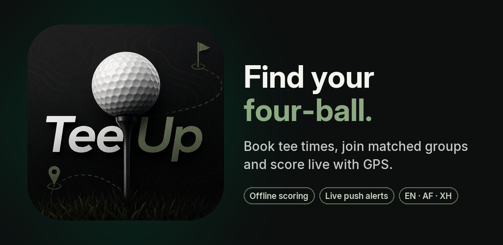

## Demo Video

**Final POE demonstration (unlisted YouTube):** [Watch the TeeUp final demo](FINAL_DEMO_VIDEO_URL)

[Prototype (Part 2) demo](https://youtu.be/wKdn8wWyUJU)
[Prototype (Part 3) demo](https://youtu.be/v_cn2hKnYms)

## Table of Contents

1. [Purpose](#1-purpose)
2. [Features](#2-features)
3. [Design Considerations](#3-design-considerations)
4. [Screenshots](#4-screenshots)
5. [Architecture](#5-architecture)
6. [Offline Mode and Synchronisation](#6-offline-mode-and-synchronisation)
7. [Real-time Push Notifications](#7-real-time-push-notifications)
8. [Tech Stack](#8-tech-stack)
9. [DevOps: Version Control, CI and Releases](#9-devops-version-control-ci-and-releases)
10. [Google Play Store Readiness](#10-google-play-store-readiness)
11. [Release Notes](#11-release-notes)
12. [Getting Started](#12-getting-started)
13. [Team](#13-team)
14. [References](#14-references)

## 1. Purpose

Booking a golf round is easy on its own, but most apps stop there. If three friends aren't free
that day, you're stuck. TeeUp lets golfers open a booked tee time to other players looking for a
game, matched on handicap range and pace of play. During the round it becomes a live GPS
scorecard, and afterwards it works out total strokes, putts, net score and Stableford points from
each player's handicap.

No single existing app combined these three ideas (Research Report, Part 1):

- Booking and hosting a real tee time at a South African course.
- Matching with golfers you don't already know, based on shared preferences, or keeping it to your
  saved playing partners.
- Scoring a round hole by hole, with GPS distances, and keeping a history of past rounds.

This project is the Programming 3D (PROG7314) Portfolio of Evidence at The Independent Institute
of Education, built by a team of three.

## 2. Features

### Core requirements

| Requirement | How TeeUp meets it | Where |
|---|---|---|
| Register and log in with SSO | Google Sign-In and email/password through Firebase Authentication. Every API call carries the Firebase ID token. | Sign In, Register |
| Biometric authentication | AndroidX `BiometricPrompt` (fingerprint or face) unlocks an existing session after the first sign-in. | Sign In, Profile → Biometric Login |
| Settings | Personal details, playing details, notification preferences, language and biometric login, all saved to the API. | Profile |
| REST API + database | ASP.NET Core Web API on Azure App Service with PostgreSQL. The app never touches the database. | All screens |
| **Offline mode with sync** | Room cache and outbox, WorkManager network-constrained sync. | Scorecard, Rounds, Home, Profile → Offline Data & Sync |
| **Real-time notifications** | Firebase Cloud Messaging sent by the API whenever a notification is created. Tokens are stored in Firebase Realtime Database. | System tray, Notifications |
| **Multi-language** | English, Afrikaans and isiXhosa for every string, switchable in-app. | Profile → Language |
| **Production assets** | Adaptive launcher icon, round, legacy and monochrome icons, notification icon, splash animation. | Launcher |

### User-defined features (from the Part 1 design)

| Feature | What it does |
|---|---|
| **Live GPS scorecard** | A satellite hole map with live front, middle and back distances that follows you hole to hole. Drag the layup target and flag, and enter strokes and putts. Works offline. |
| **Playing partners and partners-only groups** | Save the golfers you play with, then make a group visible only to them. Each partner gets a push invite. |
| Matching | Filter open groups by date, players, course, holes, host handicap and pace. Hosts approve or decline join requests. |
| Post-round statistics | Totals, average putts, net score and Stableford points worked out from your handicap, with history. |

## 3. Design Considerations

- **One consistent design system.** Every screen is built in Jetpack Compose from shared
  components in `com.teeup.android.design`: type scale (Inter), colour tokens (TeeUp green
  `#006747`), grouped lists, glass bars, sheets, spring motion and skeleton loading. This keeps
  layout, fonts and colours identical everywhere.
- **Four-tab navigation.** Home, Rounds, Scorecard and Profile cover what a returning golfer needs.
  Everything else is pushed from one of those, so the back stack stays predictable.
- **Robust input handling.** Forms validate before sending (handicap range, dates in the future,
  hole counts). API errors come back as readable `{status, detail}` messages shown in banners.
  Network failures fall back to saved data instead of crashing.
- **Offline-first where it matters.** Golf courses often have poor signal, so the scorecard is the
  feature that must never lose data (Komilov, 2025).
- **Security and privacy (POPIA).** Firebase ID tokens are verified by the API, database
  credentials never ship in the app, traffic is HTTPS only, biometrics never leave the device,
  location stays on the phone, and Realtime Database rules restrict each user to their own push
  tokens. See `docs/play-store/privacy-policy.md`.
- **Accessibility.** Semantic headings, content descriptions, TalkBack announcements for the
  offline banner, and large touch targets.
- **Observability.** `Log` calls trace every Activity lifecycle transition
  (`ui/LifecycleLogging.kt`, tag `Lifecycle`), network requests (`TeeUpApiClient`), cache hits
  (`ResponseCache`), sync runs (`ScorecardSyncWorker`), connectivity (`NetworkMonitor`) and push
  events (`TeeUpMessaging`).

## 4. Screenshots

> These screenshots were taken on a physical phone during the prototype phase. Final-version
> screens are shown in the demo video and in `docs/play-store/screenshots/`.

The app has four main tabs at the bottom of the screen once signed in:
**Home**, **Rounds**, **Scorecard**, and **Profile**. The screenshots below
follow a typical journey through the app, starting from sign-up and ending
at profile settings.

### Sign-up and sign-in

| | |
|---|---|
| 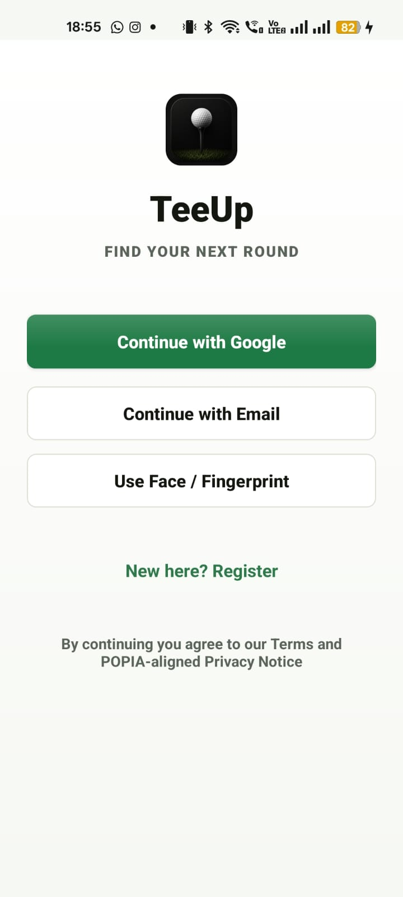 | The first screen a new or returning user sees. From here you can continue with Google, continue with email, sign in with Face/Fingerprint (once set up), or tap **New here? Register** to create an account. |
| 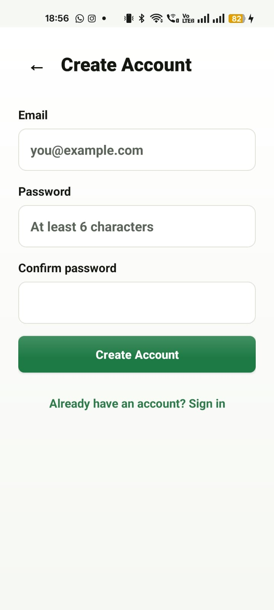 | Reached from **Continue with Email** in sign-up mode. Enter an email and password to create a Firebase account. |
| 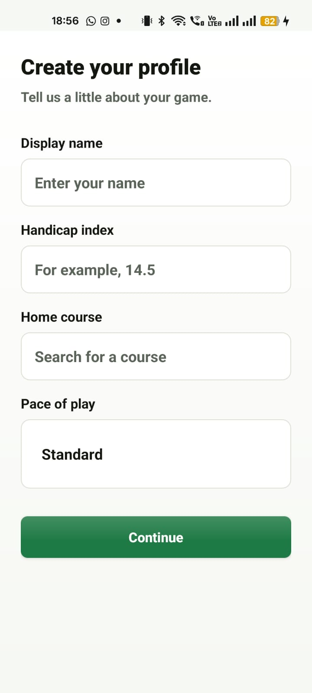 | Shown automatically right after account creation. Set your display name, handicap index, home course, and pace of play before landing on Home. |
| 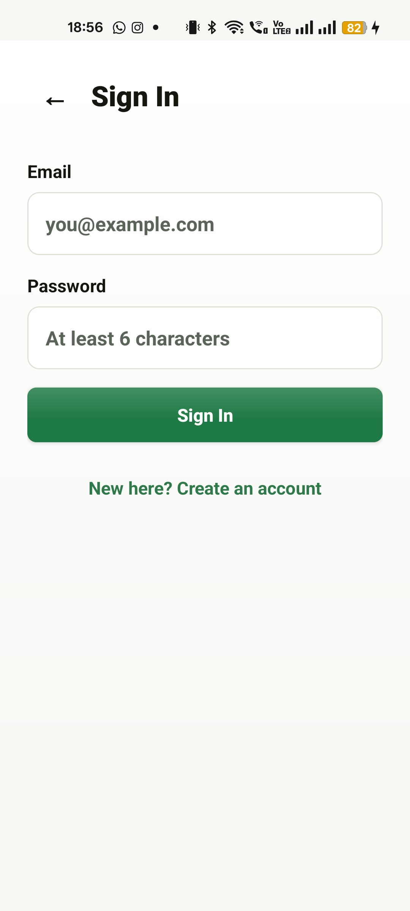 | Reached from **Continue with Email** in sign-in mode, for a returning user who already has an account. |

### Home: finding and joining a round

| | |
|---|---|
| 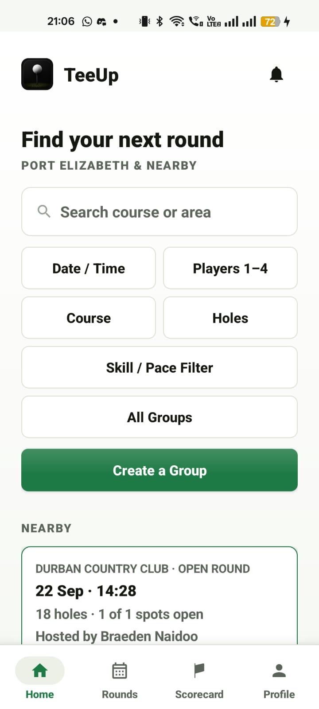 | The Home tab, reached by tapping **Home** in the bottom nav. Search by course or area, and filter by date/time, number of players, course, holes, and skill/pace. **Create a Group** starts a new group looking for players. |
| 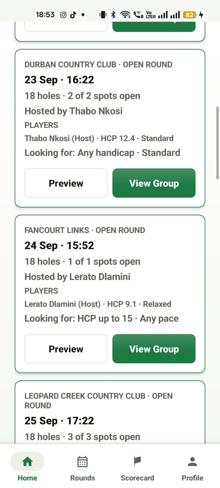 | Scrolling down on Home shows the list of nearby open groups, each with the course, date, spots open, host, and the host's handicap/pace. |
| 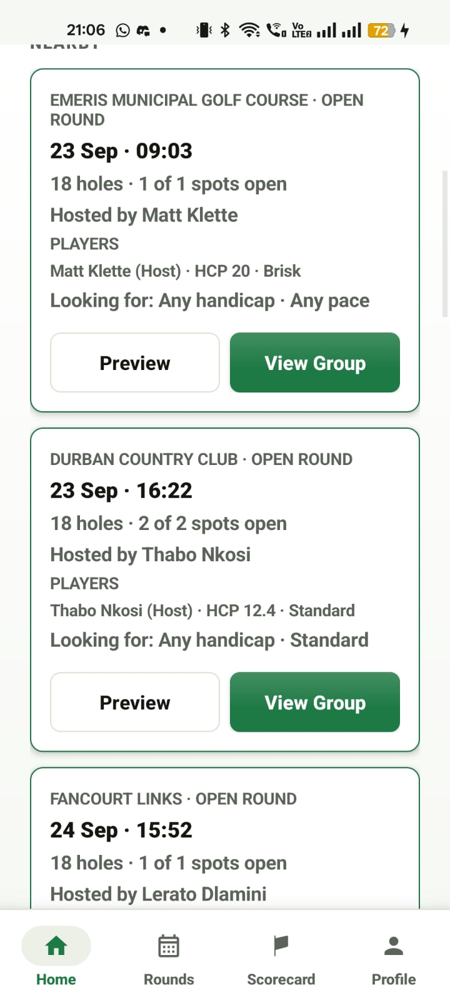 | The same list a little later, now showing a newly created group at the top alongside the earlier ones. |
| 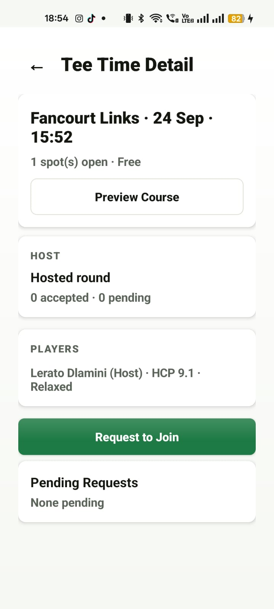 | Reached by tapping **View Group** on a listing. Shows the group's players and a **Request to Join** button for anyone who is not the host. |
| 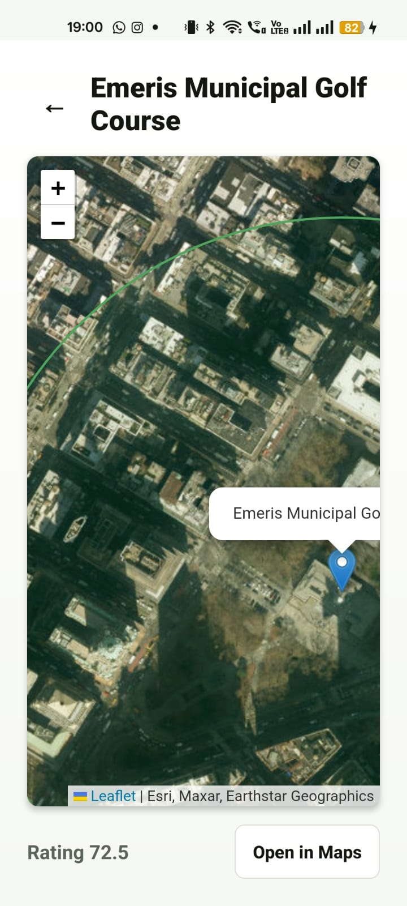 | Reached by tapping **Preview Course** from a tee time's detail screen. Shows the course location on a map, its rating, and an **Open in Maps** button. |

### Managing your own group

| | |
|---|---|
| 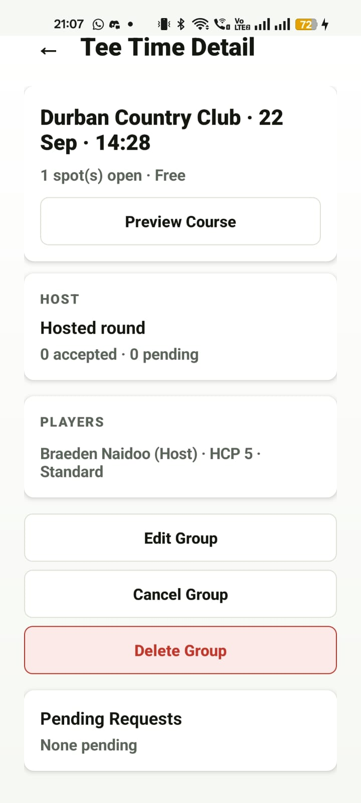 | The same detail screen, but shown to the host instead of a guest. Hosts get **Edit Group**, **Cancel Group**, and **Delete Group** buttons instead of a join request, plus a live view of pending requests. |

### Notifications

| | |
|---|---|
| 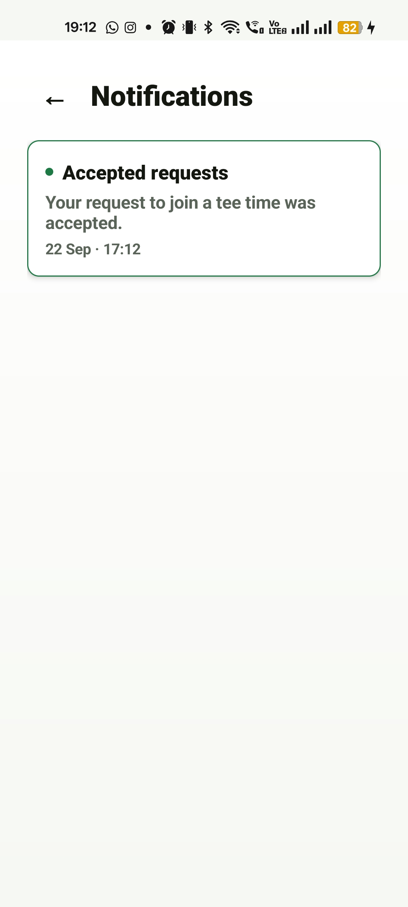 | Reached by tapping the bell icon on Home. Shows an accepted join request notification. |
| 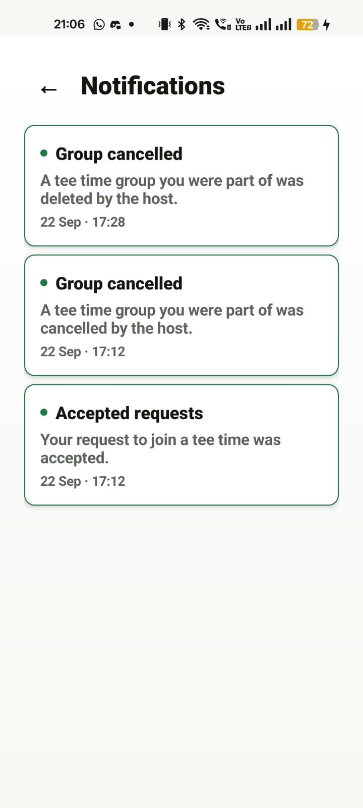 | The same screen later, now also showing group-cancelled notifications from the host side. |

### Rounds and scoring

| | |
|---|---|
| 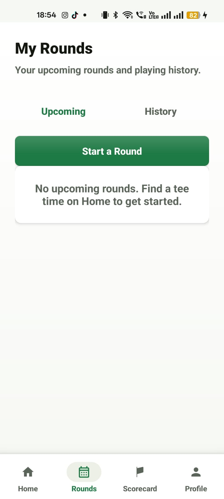 | The **Rounds** tab's Upcoming view, reached from the bottom nav, shown here with nothing scheduled yet. |
| 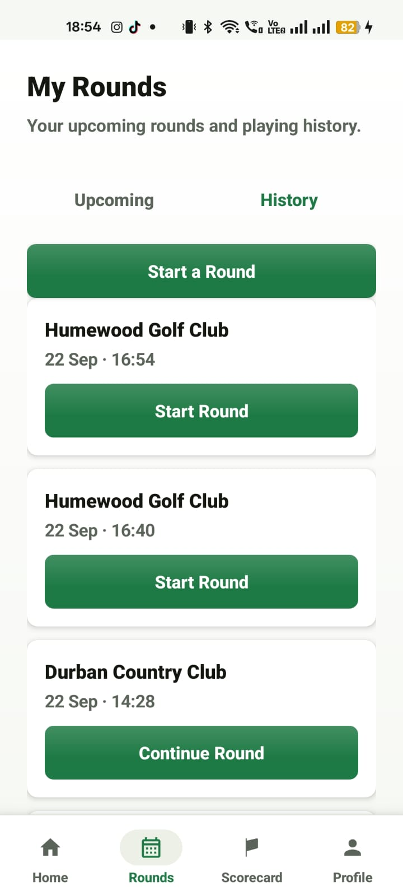 | The **History** tab on the same screen, listing past and in-progress rounds with **Start Round** / **Continue Round** buttons. |
| 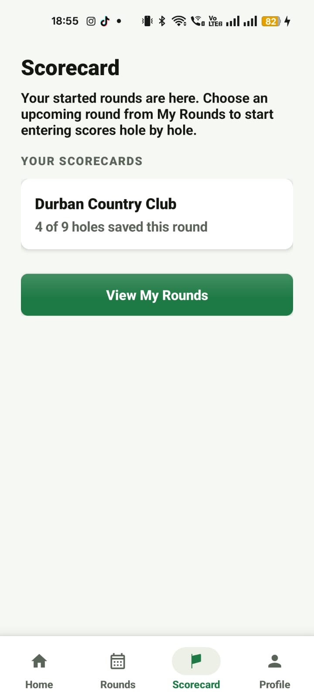 | The **Scorecard** tab, reached from the bottom nav. Lists any round currently being scored and links back to My Rounds to start a new one. |
| 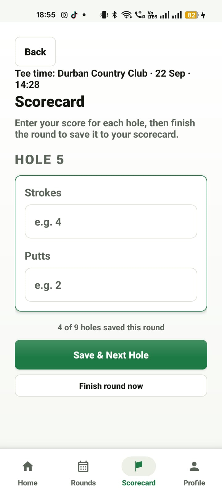 | Reached by starting or continuing a round. Enter strokes and putts for the current hole, then **Save & Next Hole**, or **Finish round now** at any point. |
| 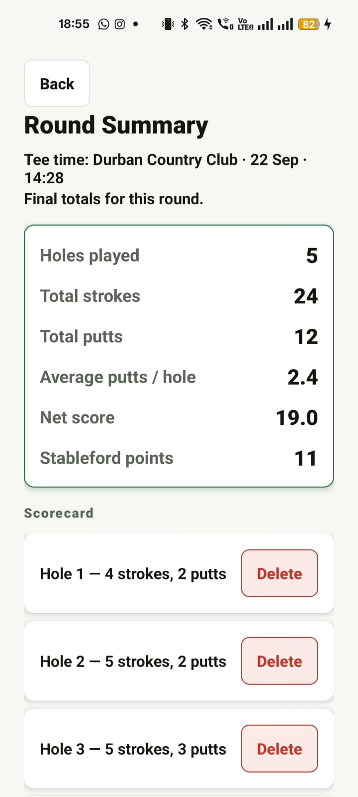 | Shown after finishing a round. Totals for strokes, putts, net score, and Stableford points, with a per-hole breakdown that can still be edited or deleted. |

### Profile

| | |
|---|---|
| 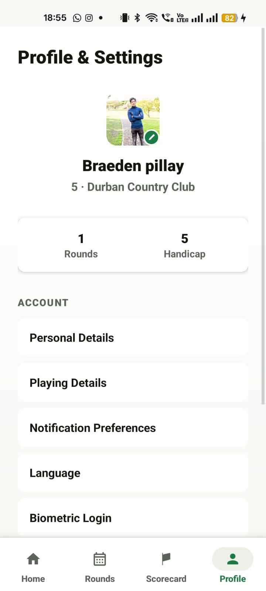 | The **Profile** tab, reached from the bottom nav. Shows rounds played and current handicap, with links to Personal Details, Playing Details, Notification Preferences, Language, and Biometric Login. |

## 5. Architecture

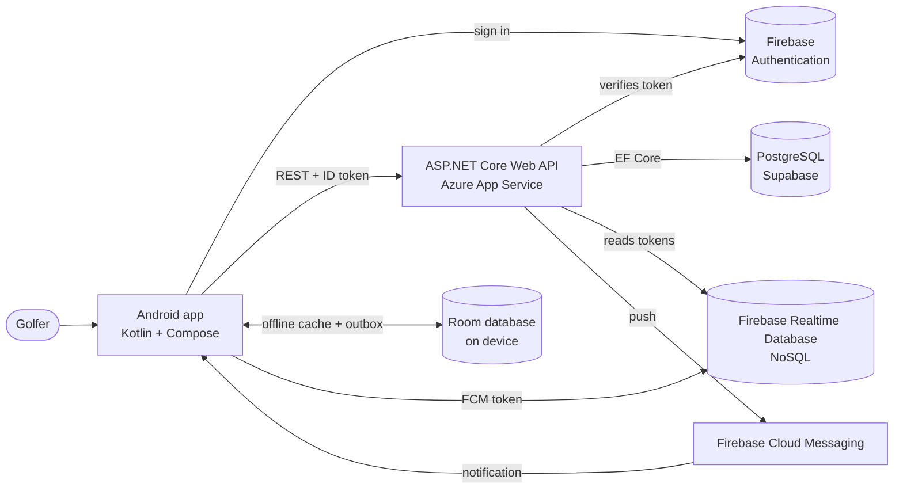

- **Android app:** MVVM. Activities host Compose screens, and ViewModels hold state as
  `StateFlow` and run network work on `Dispatchers.IO`.
- **API:** controllers → services → repositories, each with one job. Business rules (hosts can't
  over-accept, scores only after the tee time, partners-only visibility) live in services and are
  covered by xUnit tests.
- **Data:** PostgreSQL (relational data: users, groups, join requests, rounds, scores,
  partnerships) and Firebase Realtime Database (NoSQL: device push tokens, written by the app and
  read by the API).

## 6. Offline Mode and Synchronisation

| Piece | File | Role |
|---|---|---|
| Room database | `data/offline/TeeUpDatabase.kt` | `cached_responses` (last copy of each API read, per user) and `pending_scorecards` (outbox) |
| Read-through cache | `data/offline/ResponseCache.kt`, `TeeUpApiClient.request` | Saves every successful GET. Serves the saved copy when the API is unreachable. |
| Outbox | `data/offline/ScorecardOutbox.kt` | Queues a finished round when offline and schedules the sync |
| Sync job | `data/offline/ScorecardSyncWorker.kt` | WorkManager `CoroutineWorker` with a `NetworkType.CONNECTED` constraint and exponential backoff |
| Connectivity | `data/offline/NetworkMonitor.kt`, `design/OfflineBanner.kt` | Live online/offline state and the banner shown on every screen |

**Flow:** score holes as normal (progress is saved on the phone after every hole) → tap *Finish*
with no signal → the round is stored in the outbox and shows *Waiting to sync* → when the network
returns, WorkManager runs the worker, which fetches the live schedule, skips holes the server
already has, uploads the rest and clears the outbox → a notification says the round has synced and
the Rounds card turns into *View Summary*.

**Conflicts:** last write wins (Part 1). Duplicate holes are never re-sent. A round the server
rejects (4xx) is kept with the reason on *Offline Data & Sync Status* instead of retrying forever.

## 7. Real-time Push Notifications

1. After sign-in, Home asks for the notification permission (Android 13+) and
   `DeviceTokenRegistrar` writes the FCM token to Realtime Database at `deviceTokens/{uid}/{token}`.
2. When the API saves a notification (join request received, accepted or declined, group
   cancelled or deleted, partners-only invite), `PushingNotificationRepository` checks the
   recipient's preferences, reads their tokens and sends an FCM message with the Firebase Admin
   SDK. Dead tokens are deleted.
3. `TeeUpMessagingService` shows the push in the foreground, and an open Notifications screen
   refreshes immediately. In the background Android shows it on the *Group alerts* channel.
4. Signing out removes the device's token.

## 8. Tech Stack

| Layer | Technology |
|---|---|
| Mobile app | Kotlin, Jetpack Compose, ViewModel + StateFlow, coroutines |
| Local storage | Room (KSP), SharedPreferences |
| Background work | WorkManager |
| Authentication | Firebase Authentication (Google, email/password), AndroidX Biometric |
| Push | Firebase Cloud Messaging, Firebase Admin SDK (.NET) |
| NoSQL | Firebase Realtime Database |
| Maps | MapLibre GL (bundled), OpenStreetMap hole data |
| Backend API | ASP.NET Core Web API (.NET 10), Entity Framework Core |
| Database | PostgreSQL on Supabase |
| Hosting | Azure App Service |
| Testing | JUnit 4 (248 Android unit tests), xUnit (171 API tests, 4 skipped without a database) |
| CI | GitHub Actions |

## 9. DevOps: Version Control, CI and Releases

- **Branching:** every piece of work is a ticket with its own branch named after it (for example
  `EME-304_Automated_Post_Round_Stats_&_History`). Work reaches `main` through reviewed pull
  requests, so `main` always builds.
- **Commits:** small, frequent commits with descriptive messages (conventional `feat:`/`fix:`
  prefixes on recent work). All three team members contribute and are credited.
- **Continuous integration:** two GitHub Actions workflows run on **every push and pull request on
  every branch**:
  - `android-ci.yml`: JDK 17, `./gradlew build` (compile, lint including translation checks,
    debug and release builds) and `./gradlew test`, with test reports uploaded as artefacts.
  - `api-ci.yml`: .NET 10 restore, Release build and `dotnet test`, with TRX results uploaded.
- **Secrets:** the Firebase config, signing keystore and API credentials are never committed.
  CI builds with a placeholder `google-services.json`, and the release signing values come from
  `android/keystore.properties` (gitignored) or `TEEUP_*` environment variables.
- **Release tag:** the final deployment commit is tagged **`final-poe`** (annotated, "Final POE").
- **Repository hygiene:** no zip files or build outputs in the repository (`*.zip`, `publish/`,
  keystores are gitignored).

## 10. Google Play Store Readiness

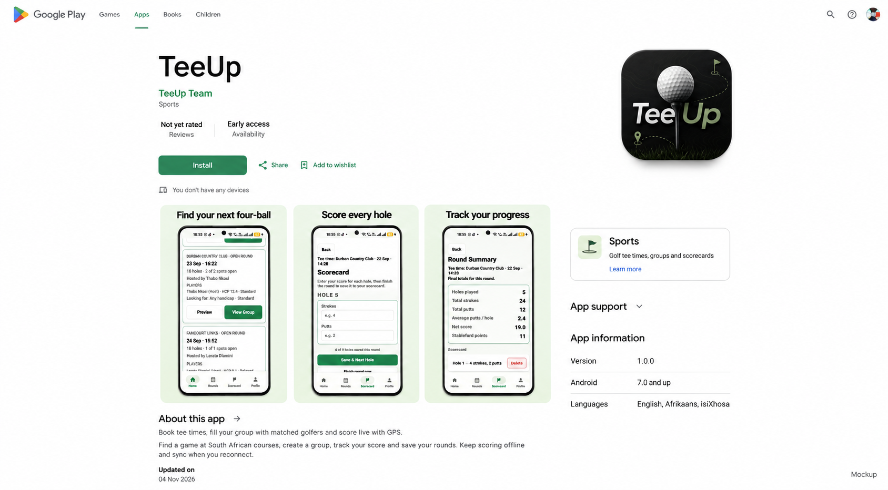

*Proposed Google Play Store listing — mockup.*

| Item | Status |
|---|---|
| Signed production build | Release APK signed with the TeeUp upload key (APK Signature Scheme v2), R8 shrinking and obfuscation, resource shrinking |
| Versioning | `versionCode 2`, `versionName 1.0.0` |
| App Bundle | `./gradlew bundleRelease` produces `app-release.aab` for upload |
| Icons | 512 x 512 store icon, adaptive, round and monochrome launcher icons |
| Feature graphic | 1024 x 500 (`docs/play-store/feature-graphic.png`) |
| Screenshots | `docs/play-store/screenshots/` |
| Listing text, content rating, data safety | `docs/play-store/listing.md` |
| Privacy policy | `docs/play-store/privacy-policy.md` |
| Network security | HTTPS only (`usesCleartextTraffic="false"`) |

## 11. Release Notes

Full notes: **[RELEASE_NOTES.md](RELEASE_NOTES.md)**. New in the final version (1.0.0), since the
prototype:

- **Offline mode with sync** (Room + WorkManager): view saved data and finish rounds offline.
  They upload automatically when you reconnect.
- **Real-time push notifications** (FCM): join requests, accepted/declined requests, cancelled
  groups and partner invites arrive instantly.
- **Playing partners and partners-only groups**, the private-groups feature from Part 1.
- **Live GPS hole map scorecard** with draggable markers and a real South African course catalogue.
- **Full Afrikaans and isiXhosa** coverage, enforced by CI.
- **Compose redesign**, production launcher icon and splash animation.
- **Store-ready release build:** signing, R8, HTTPS-only, listing assets and privacy policy.
- **Lifecycle and state logging** throughout the app.

## 12. Getting Started

Requirements: Android Studio (JDK 17, Android SDK 36), .NET 10 SDK, and a PostgreSQL database
(local) or access to the shared Supabase database.

1. Clone the repository.
2. API: see `api/README.md` for the connection string, Firebase settings
   (`Firebase__ProjectId`, `Firebase__ServiceAccountJson`, `Firebase__DatabaseUrl`) and migrations.
3. App: put your Firebase `google-services.json` in `android/app/`, open `android/` in Android
   Studio and run on a phone (Android 7.0+).
4. Release build: copy `android/keystore.properties.example` to `android/keystore.properties`,
   fill it in, then run `./gradlew assembleRelease` or `./gradlew bundleRelease`.

## 13. Team

Built by the Emeris team:

- Brandon van der Walt
- Matt Klette
- Braeden Naidoo

## 14. References

Android Developers (2026a). *Save data in a local database using Room*. Available at: <https://developer.android.com/training/data-storage/room> [Accessed 3 Nov. 2026].

Android Developers (2026b). *Monitor connectivity status and connection metering*. Available at: <https://developer.android.com/training/basics/network-ops/reading-network-state> [Accessed 3 Nov. 2026].

Android Developers (2026c). *Create and manage notification channels*. Available at: <https://developer.android.com/develop/ui/views/notifications/channels> [Accessed 3 Nov. 2026].

Android Developers (2026d). *Define work requests*. Available at: <https://developer.android.com/develop/background-work/background-tasks/persistent/getting-started/define-work> [Accessed 3 Nov. 2026].

Android Developers (2026e). *The activity lifecycle*. Available at: <https://developer.android.com/guide/components/activities/activity-lifecycle> [Accessed 3 Nov. 2026].

Android Developers (2026f). *Show a biometric authentication dialog*. Available at: <https://developer.android.com/identity/sign-in/biometric-auth> [Accessed 3 Nov. 2026].

Firebase (2026a). *Receive messages in an Android app*. Available at: <https://firebase.google.com/docs/cloud-messaging/android/receive> [Accessed 3 Nov. 2026].

Firebase (2026b). *Read and write data on Android*. Available at: <https://firebase.google.com/docs/database/android/read-and-write> [Accessed 3 Nov. 2026].

Komilov, Y. (2025). *Offline-first Android app design: Room, WorkManager, and data sync*. Medium. Available at: <https://medium.com/@YodgorbekKomilo/offline-first-android-app-design-room-workmanagerand-data-sync-day-9-of-system-design-76b48349d286> [Accessed 3 Nov. 2026].
